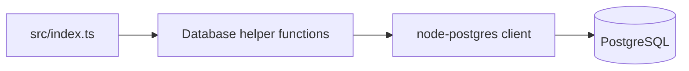

# PostgreSQL with TypeScript

**Follow a small database workflow from table creation to insert, read, update, and delete.**

This learning repository uses the `pg` driver directly. Individual functions handle user and address operations, while a single entry point demonstrates the sequence.

## What you can learn

- Creating relational tables with SQL.
- Opening and closing PostgreSQL client connections.
- Inserting users and linked addresses.
- Reading a user and updating their email address.
- Deleting the demonstration user.

## Setup

Use Node.js/npm and a PostgreSQL database reserved for this exercise. Review the connection settings in `src/database/` before running anything: the current examples define connection strings in source, so creating a `.env` file alone does not configure them.

```bash
npm install
npm install --save-dev typescript @types/node
npm run build
npm start
```

The TypeScript compiler is needed by the build command but is not declared in the current package manifest. The commands above add it to the downloaded working copy. Configure each database helper consistently with your own database and SSL requirements.

The example creates tables and modifies sample rows. Use a disposable learning database.

## Architecture



| File | Operation |
|---|---|
| [`src/database/createTables.ts`](src/database/createTables.ts) | Create user and address tables |
| [`src/database/insertUser.ts`](src/database/insertUser.ts) | Add a user |
| [`src/database/insertAddress.ts`](src/database/insertAddress.ts) | Add a related address |
| [`src/database/getUser.ts`](src/database/getUser.ts) | Retrieve a user |
| [`src/database/updateUserEmail.ts`](src/database/updateUserEmail.ts) | Change an email |
| [`src/database/deleteUser.ts`](src/database/deleteUser.ts) | Delete a user |

## Example flow

`src/index.ts` creates the tables, adds a sample user and address, reads the user, changes the email, and removes the user. Read that entry point first to understand the sequence before adapting individual functions.

This is a database exercise, not an HTTP API or authentication system. Although the package defines a Jest command, Jest and a test suite are not supplied by the current manifest/tree.
